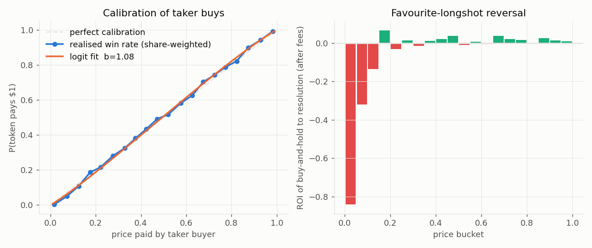
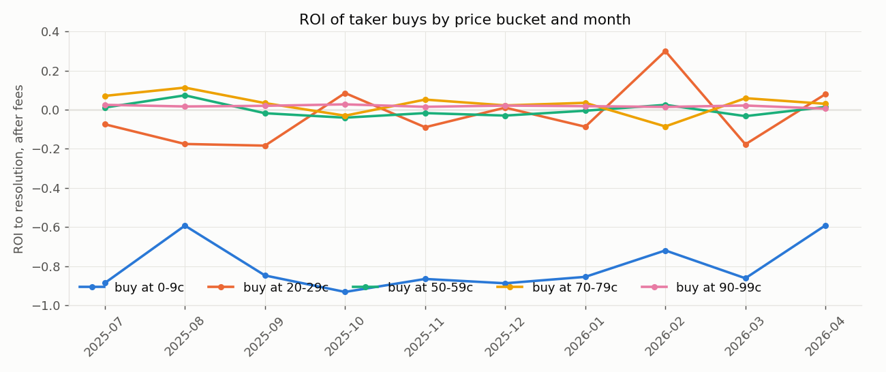
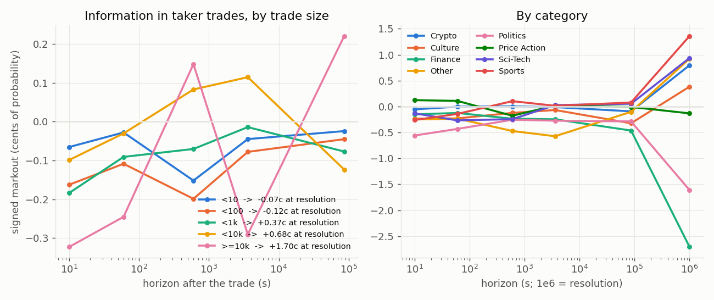
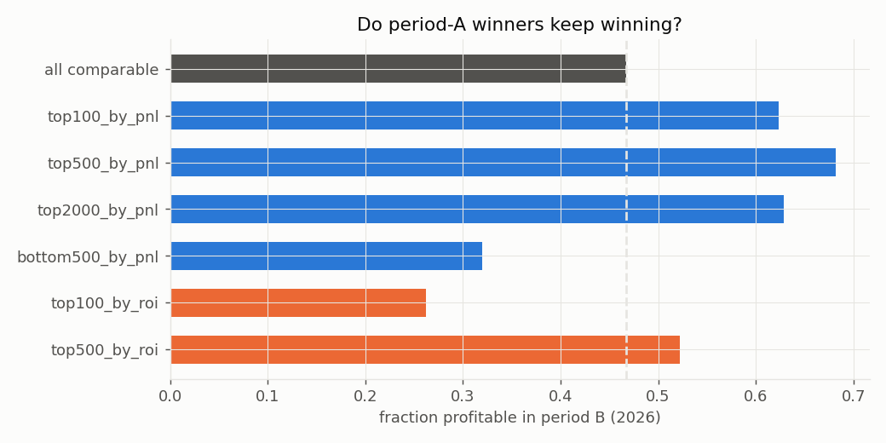
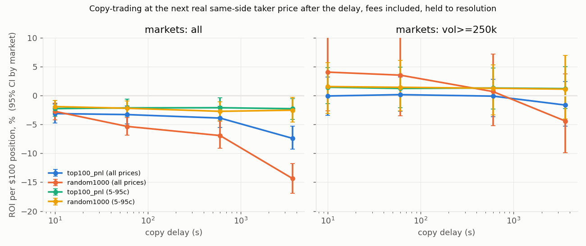

# Polymarket first-principles research report

Window: 2025-07-01 to 2026-04-28 (v1 exchange tape). Period A = markets last traded before 2026-01-01, period B = 2026.

## Summary

- **Concentration.** 1,928,488 wallets traded 798,744 resolved markets ($21.0B one-sided notional). 64% lost money. Profit is exactly zero-sum ($792M won = $792M lost); the top 1% of wallets took 84% of it.
- **Persistence.** Of the top-100 wallets by pre-2026 profit, 62% were profitable again in Jan-Apr 2026 vs 47% of all comparable wallets (top-500: 68%). Ranking by past ROI instead selects longshot luck: 26% profitable. Rank correlation of ROI across periods is ~0.12-0.23; the shrinkage model says to believe only ~10-30% of a wallet's past ROI.
- **Who persists: makers.** Within the top 100, maker-style wallets (<30% of notional as aggressor) were profitable again 77% of the time ($23.2M), taker-style wallets 50% ($0.5M). Most top wallets trade both sides of the same market.
- **Copying does not work.** $100 per new position, next real same-side taker price, fees per Polymarket's schedule, 10s delay, markets >=$250k and prices 5-95c: top-100 +1.4% [-1.4%, +4.8%], 1,000 random wallets +1.6% [-3.1%, +5.7%]. Over all markets and prices: top-100 -3.1% [-4.8%, -1.5%], random -2.7% [-4.2%, -1.4%]. The edge of the winners does not survive the trip to a copier.
- **Calibration.** Prices are slightly under-confident overall (logit slope b=1.08, share-weighted): buying below 5c loses ~84% and 5-10c ~32% to resolution, while 65-95c favourites earn +1-4%. By category the slope is ~1 for sports and politics and >1 for crypto, so the reversal is mostly a crypto/price-action phenomenon.
- **Information.** Ordinary taker trades carry almost no information that the market prices in before resolution: markouts are flat for a day and jump only at settlement. The exceptions are the largest trades (>=$10k: +1.7c at resolution) and the top-100 wallets, whose trades move the price in their favour within 10 seconds (+0.35c) and are worth +4c at resolution. That is a speed edge, not a copyable one.
- **Market making.** Glosten-Milgrom accounting (half-spread from bounce minus adverse selection from taker markouts): providing liquidity is positive-edge in politics (+2.2c/share) and finance, roughly flat in price-action markets, and negative in sports and crypto where takers are informed in-game (-1.1c and -0.7c per share before rebates).

## Methods and validation

- **Data.** Hugging Face `TimeSeventeen/Polymarket-v1` (CC-BY-4.0): cleaned on-chain `OrderFilled` tape of the v1 CTF Exchange on Polygon, 2025-07-01 to 2026-04-28 (the v2 cut-over day). One row per maker/taker fill with the taker's direction; shares = notional/price. Resolution from `ConditionResolution` payout numerators (the dataset's `winning_outcome_label` has whitespace mismatches and is not used).
- **Ledger.** Wallet x market profit = cash from fills + net shares x payout. Short positions are the on-chain footprint of split-and-sell and the formula stays exact (short YES at p == long NO at 1-p). Reconciled against Polymarket's Data API closed positions: July 2025, 92% of 1,167 wallet-markets within $1, aggregate within 0.2%; April 2026 (fee markets), median difference $0.26 with no fee deducted.
- **Fees.** The dataset's `fee_usdc` is the raw on-chain fee field of the maker order (USDC units when the maker sold, token units when it bought, computed at the 10% cap rate). Polymarket's own PnL accounting does not deduct it and third-party estimates of real Q1-2026 net fees (~$24M) are an order of magnitude below its sum ($335M), so wallet profit is reported gross of it. Copier and calibration fees use the published schedule, fee = feeRate x p x (1-p) per share (crypto 0.07, sports 0.03, politics/finance/tech 0.04, others 0.05, geopolitics 0), on markets flagged fee-enabled.
- **Out of sample.** Wallets are ranked on markets last traded before 2026-01-01 (>=20 markets, >=$10k cost basis) and evaluated on 2026. Copy signals are the first fill of a wallet in a market (capped at 1,000 random markets per wallet); execution is the next real taker fill on the same side at or after t0+delay; CIs bootstrap over markets.
- **Markouts.** 2% random sample of resolved markets (~13M fills); signed markout = D x (p(t+h) - p(t)) with p(t+h) the first trade at or after t+h; share-weighted.
- **Caveats.** v1 contracts only (v2 since 2026-04-28 has pUSD collateral and a new fee structure); maker rebates not modelled; no order-book data, so half-spreads are inferred from bounce; period B is four months and includes the fee roll-out; the ROI-ranked wallets are few and noisy.

## 1. Calibration and the favourite-longshot reversal

|   price bucket |       fills |   markets |   avg price |   win rate (share-wt) |   ROI after fees |   fee rate |
|---------------:|------------:|----------:|------------:|----------------------:|-----------------:|-----------:|
|           0    | 1.15234e+07 |    249479 |      0.0162 |                0.0026 |          -0.8397 |     0.0002 |
|           0.05 | 4.25996e+06 |    214009 |      0.0726 |                0.0494 |          -0.3195 |     0.0006 |
|           0.1  | 3.93413e+06 |    207196 |      0.1252 |                0.1085 |          -0.1347 |     0.0011 |
|           0.15 | 2.88846e+06 |    181837 |      0.1761 |                0.1879 |           0.0655 |     0.0013 |
|           0.2  | 3.19696e+06 |    185720 |      0.2213 |                0.215  |          -0.0304 |     0.0017 |
|           0.25 | 4.21656e+06 |    201877 |      0.2753 |                0.2801 |           0.0153 |     0.0021 |
|           0.3  | 3.62968e+06 |    184676 |      0.3288 |                0.3253 |          -0.0132 |     0.0025 |
|           0.35 | 3.63195e+06 |    181271 |      0.3755 |                0.3808 |           0.0113 |     0.0027 |
|           0.4  | 4.32903e+06 |    190391 |      0.4233 |                0.4335 |           0.021  |     0.003  |
|           0.45 | 4.53204e+06 |    199881 |      0.4721 |                0.4919 |           0.0389 |     0.0029 |
|           0.5  | 5.57204e+06 |    218752 |      0.5197 |                0.5162 |          -0.0092 |     0.0024 |
|           0.55 | 4.72377e+06 |    202134 |      0.5763 |                0.5819 |           0.0069 |     0.0028 |
|           0.6  | 3.39757e+06 |    179423 |      0.626  |                0.6246 |          -0.0048 |     0.0025 |
|           0.65 | 4.14572e+06 |    198327 |      0.6751 |                0.7025 |           0.0382 |     0.0025 |
|           0.7  | 3.15144e+06 |    185138 |      0.7243 |                0.7422 |           0.0226 |     0.0021 |
|           0.75 | 3.67338e+06 |    197395 |      0.7721 |                0.7864 |           0.0167 |     0.0019 |
|           0.8  | 3.55189e+06 |    196851 |      0.8224 |                0.8214 |          -0.0027 |     0.0015 |
|           0.85 | 4.0122e+06  |    206702 |      0.874  |                0.8984 |           0.0268 |     0.0011 |
|           0.9  | 5.55226e+06 |    238340 |      0.9273 |                0.9409 |           0.0139 |     0.0007 |
|           0.95 | 1.32627e+07 |    402282 |      0.9828 |                0.9921 |           0.0093 |     0.0002 |

Logit fit (share-weighted): a=0.027, b=1.077. b>1 means the market is under-confident: favourites are underpriced, longshots overpriced.

Model-implied edge and Kelly fraction for buying at a given price (no fee):

|   price |   q_true |     roi |   kelly |
|--------:|---------:|--------:|--------:|
|    0.02 |   0.0153 | -0.2336 |  0      |
|    0.05 |   0.0414 | -0.1724 |  0      |
|    0.1  |   0.088  | -0.1199 |  0      |
|    0.2  |   0.1877 | -0.0616 |  0      |
|    0.3  |   0.2922 | -0.0261 |  0      |
|    0.4  |   0.3991 | -0.0022 |  0      |
|    0.5  |   0.5069 |  0.0137 |  0.0137 |
|    0.6  |   0.6139 |  0.0232 |  0.0349 |
|    0.7  |   0.719  |  0.0272 |  0.0634 |
|    0.8  |   0.8205 |  0.0257 |  0.1026 |
|    0.9  |   0.9163 |  0.0181 |  0.1629 |
|    0.95 |   0.9607 |  0.0113 |  0.2148 |
|    0.98 |   0.9855 |  0.0056 |  0.2739 |

## 2. Stability over time and the arrival of fees

Notional-weighted taker fee rate by month:

|          |   2025-07 |   2025-08 |   2025-09 |   2025-10 |   2025-11 |   2025-12 |   2026-01 |   2026-02 |   2026-03 |   2026-04 |
|:---------|----------:|----------:|----------:|----------:|----------:|----------:|----------:|----------:|----------:|----------:|
| fee rate |     2e-05 |     3e-05 |     7e-05 |     5e-05 |     4e-05 |     4e-05 |   0.00085 |   0.00122 |   0.00152 |   0.00302 |

## 3. Information decay and market making (Glosten-Milgrom)

Share-weighted signed markouts of taker fills (probability units; positive = the taker was right):

| group        |   fills |   notional $ |     10s |      1m |     10m |      1h |      1d |   resolution |    fee |
|:-------------|--------:|-------------:|--------:|--------:|--------:|--------:|--------:|-------------:|-------:|
| all          | 8119830 |  3.66274e+08 | -0.0017 | -0.001  | -0.0001 | -0.0003 | -0.0003 |       0.0057 | 0.002  |
| a<10         | 5476399 |  2.52431e+07 | -0.0007 | -0.0003 | -0.0015 | -0.0004 | -0.0002 |      -0.0007 | 0.0088 |
| b<100        | 2239458 |  6.35736e+07 | -0.0016 | -0.0011 | -0.002  | -0.0008 | -0.0005 |      -0.0012 | 0.0044 |
| c<1k         |  357240 |  1.03202e+08 | -0.0018 | -0.0009 | -0.0007 | -0.0001 | -0.0008 |       0.0037 | 0.0012 |
| d<10k        |   44217 |  1.12894e+08 | -0.001  | -0.0003 |  0.0008 |  0.0011 | -0.0012 |       0.0068 | 0.0006 |
| e>=10k       |    2516 |  6.13609e+07 | -0.0032 | -0.0025 |  0.0015 | -0.0029 |  0.0022 |       0.017  | 0.0007 |
| Crypto       | 1732760 |  6.60484e+07 | -0.0005 | -0      |  0      | -0.0001 | -0.0009 |       0.008  | 0.0019 |
| Culture      |  101733 |  7.04999e+06 | -0.0023 | -0.0023 | -0.0012 | -0.0007 | -0.0032 |       0.0038 | 0.0001 |
| Finance      |   59878 |  1.02634e+07 | -0.0015 | -0.0012 | -0.0023 | -0.0025 | -0.0046 |      -0.0271 | 0.0001 |
| Other        |   41161 |  4.93749e+06 | -0.0025 | -0.0023 | -0.0047 | -0.0057 | -0.001  |       0.0093 | 0.0002 |
| Politics     |  165794 |  1.7595e+07  | -0.0056 | -0.0043 | -0.0025 | -0.0027 | -0.0029 |      -0.0161 | 0.0001 |
| Price Action | 4365911 |  5.93787e+07 |  0.0012 |  0.0011 | -0.0018 |  0.0002 | -0.0001 |      -0.0013 | 0.0071 |
| Sci-Tech     |   21533 |  1.92678e+06 | -0.0013 | -0.0027 | -0.0024 |  0.0003 |  0.0005 |       0.0094 | 0.0012 |
| Sports       | 1280692 |  1.78805e+08 | -0.0026 | -0.0014 |  0.001  |  0.0001 |  0.0008 |       0.0136 | 0.001  |

Maker economics per share: half-spread (bounce) minus adverse selection minus fee:

| grp          |   half_spread_est |   adverse_selection |   maker_edge_per_share |
|:-------------|------------------:|--------------------:|-----------------------:|
| all          |            0.0017 |              0.0057 |                -0.004  |
| a<10         |            0.0007 |             -0.0007 |                 0.0014 |
| b<100        |            0.0016 |             -0.0012 |                 0.0029 |
| c<1k         |            0.0018 |              0.0037 |                -0.0019 |
| d<10k        |            0.001  |              0.0068 |                -0.0058 |
| e>=10k       |            0.0032 |              0.017  |                -0.0138 |
| Crypto       |            0.0005 |              0.008  |                -0.0074 |
| Culture      |            0.0023 |              0.0038 |                -0.0015 |
| Finance      |            0.0015 |             -0.0271 |                 0.0286 |
| Other        |            0.0025 |              0.0093 |                -0.0068 |
| Politics     |            0.0056 |             -0.0161 |                 0.0217 |
| Price Action |           -0.0012 |             -0.0013 |                 0.0001 |
| Sci-Tech     |            0.0013 |              0.0094 |                -0.0081 |
| Sports       |            0.0026 |              0.0136 |                -0.011  |

Fraction of the terminal markout already in the price by horizon h (M(h)/M_inf), groups with |M_inf| > 0.3c. Values near 0 mean the information is realised only at resolution, not traded into the price:

| grp      |   winf |   realised by 10s |   realised by 1m |   realised by 10m |   realised by 1h |   realised by 1d |
|:---------|-------:|------------------:|-----------------:|------------------:|-----------------:|-----------------:|
| all      |  0.006 |            -0.295 |           -0.169 |            -0.025 |           -0.059 |           -0.056 |
| c<1k     |  0.004 |            -0.491 |           -0.243 |            -0.188 |           -0.038 |           -0.206 |
| d<10k    |  0.007 |            -0.146 |           -0.045 |             0.122 |            0.169 |           -0.182 |
| e>=10k   |  0.017 |            -0.19  |           -0.144 |             0.087 |           -0.171 |            0.13  |
| Crypto   |  0.008 |            -0.068 |           -0.003 |             0.003 |           -0.014 |           -0.116 |
| Culture  |  0.004 |            -0.607 |           -0.595 |            -0.319 |           -0.174 |           -0.841 |
| Finance  | -0.027 |             0.056 |            0.046 |             0.087 |            0.091 |            0.171 |
| Other    |  0.009 |            -0.269 |           -0.251 |            -0.509 |           -0.619 |           -0.11  |
| Politics | -0.016 |             0.347 |            0.268 |             0.158 |            0.169 |            0.178 |
| Sci-Tech |  0.009 |            -0.14  |           -0.284 |            -0.259 |            0.03  |            0.058 |
| Sports   |  0.014 |            -0.191 |           -0.105 |             0.076 |            0.011 |            0.057 |

The exponential-decay model M(h) = M_inf - (M_inf - M_0) exp(-h/tau) is rejected for most groups (fitted tau diverges, see info_decay_fits.json): markouts are flat or negative for a day and then jump at resolution. The information in ordinary taker trades is not incorporated by the market before the outcome; only the largest trades and top wallets move the price within seconds.

Top-100 (period-A pnl) wallets as takers vs everyone else:

| is_top   | period_b   |       n |    notional |    w10s |     w1m |    w10m |     w1h |     w1d |   winf |    m10s |     m1m |    m10m |     m1h |     m1d |    minf |   fee_rate |
|:---------|:-----------|--------:|------------:|--------:|--------:|--------:|--------:|--------:|-------:|--------:|--------:|--------:|--------:|--------:|--------:|-----------:|
| False    | False      | 1339676 | 1.08844e+08 | -0.003  | -0.0025 | -0.0029 | -0.0016 |  0.0001 | 0.0075 | -0.0028 | -0.0026 | -0.0044 | -0.0033 | -0.0025 | -0.0049 |     0.0001 |
| False    | True       | 6622833 | 2.26971e+08 | -0.0019 | -0.0012 |  0.0002 | -0.0009 | -0.0008 | 0.0028 | -0.0006 | -0.0003 | -0.0031 | -0.0013 | -0.0032 |  0.0001 |     0.0032 |
| True     | False      |   72793 | 1.85465e+07 |  0.0035 |  0.0063 |  0.0089 |  0.016  | -0.0001 | 0.0072 |  0.0064 |  0.0082 |  0.0106 |  0.0062 | -0.0046 |  0.01   |     0      |
| True     | True       |   84528 | 1.19126e+07 |  0.0053 |  0.0065 |  0.0055 | -0.0038 |  0.0051 | 0.0425 |  0.0071 |  0.0077 |  0.0078 |  0.008  |  0.0234 |  0.0071 |     0.0012 |

## 4. Concentration and skill persistence

- Wallets: 1,928,488; losing: 63.8%; top 1% of wallets took 84.3% of all profits; top 100 took 23.7%. Markets: 798,744.

| group            |     n |   still_active |   frac_profitable_b |   mean_roi_b |   median_roi_b |        sum_pnl_b |
|:-----------------|------:|---------------:|--------------------:|-------------:|---------------:|-----------------:|
| all comparable   | 51475 |          35966 |               0.467 |       -0.035 |         -0.001 |      5.77613e+07 |
| top100_by_pnl    |   100 |             61 |               0.623 |       -0.012 |          0.008 |      2.51309e+07 |
| top500_by_pnl    |   500 |            387 |               0.682 |        0.007 |          0.009 |      4.44059e+07 |
| top2000_by_pnl   |  2000 |           1512 |               0.629 |        0.053 |          0.008 |      5.74956e+07 |
| bottom500_by_pnl |   500 |            316 |               0.32  |       -0.066 |         -0.025 |      3.05251e+06 |
| top100_by_roi    |   100 |             42 |               0.262 |       -0.275 |         -0.194 | -27288.9         |
| top500_by_roi    |   500 |            291 |               0.522 |       -0.039 |          0.001 | 161401           |
| top2000_by_roi   |  2000 |           1245 |               0.575 |        0.029 |          0.006 |      1.6335e+06  |
| bottom500_by_roi |   500 |            232 |               0.474 |       -0.103 |         -0.011 | 160439           |

Skill-shrinkage model (how much of period-A ROI predicts period-B ROI):

|                    |   rank_corr |   shrinkage_20mkts_10k |   shrinkage_50mkts_50k |
|:-------------------|------------:|-----------------------:|-----------------------:|
| n                  |  35966      |             35966      |              9399      |
| spearman_roi       |      0.1202 |               nan      |               nan      |
| spearman_pnl       |      0.1725 |               nan      |               nan      |
| reliability_ols    |    nan      |                 0.2138 |                 1.087  |
| reliability_winsor |    nan      |                 0.1168 |                 0.302  |
| spearman           |    nan      |                 0.1202 |                 0.2337 |
| mean_roi_a         |    nan      |                -0.0042 |                -0.0028 |
| mean_roi_b         |    nan      |                -0.0347 |                -0.0218 |
| var_a              |    nan      |                 0.0093 |                 0.004  |
| cov_ab             |    nan      |                 0.002  |                 0.0043 |

Trading style of the top-100 wallets (by period-A profit) and what happened to each style in period B. Taker share = fraction of notional where the wallet was the aggressor; both-sides = fraction of markets where it traded both outcome tokens:

| style              |   n |       pnl_A |            pnl_B |   still_active |   profitable_B |   both_sides_frac |   median_fills_per_mkt |   median_markets |
|:-------------------|----:|------------:|-----------------:|---------------:|---------------:|------------------:|-----------------------:|-----------------:|
| maker (<30% taker) |  31 | 3.14737e+07 |      2.32038e+07 |             22 |          0.773 |             0.564 |                 28.022 |           1504   |
| mixed              |  48 | 4.0344e+07  |      1.39008e+06 |             29 |          0.552 |             0.646 |                 42.785 |            496.5 |
| taker (>70% taker) |  21 | 2.38325e+07 | 537089           |             10 |          0.5   |             0.703 |                 43.066 |            120   |

## 5. Copy-trading backtest

The top100_roi group (ranked by period-A ROI) is omitted from the chart: it has only a few hundred positions and its CIs span tens of percent; see the table.

|   delay_s |   n_positions |   n_markets |     roi |   ci_lo |   ci_hi | group      | band      | markets   |
|----------:|--------------:|------------:|--------:|--------:|--------:|:-----------|:----------|:----------|
|        10 |         30388 |       21413 | -0.0312 | -0.0479 | -0.0147 | top100_pnl | 0-1       | all       |
|        60 |         30290 |       21331 | -0.0329 | -0.0494 | -0.0176 | top100_pnl | 0-1       | all       |
|       600 |         29538 |       20646 | -0.039  | -0.0551 | -0.0185 | top100_pnl | 0-1       | all       |
|      3600 |         27404 |       18866 | -0.074  | -0.0928 | -0.0527 | top100_pnl | 0-1       | all       |
|        10 |         27811 |       19330 | -0.0226 | -0.0361 | -0.0087 | top100_pnl | 0.05-0.95 | all       |
|        60 |         27632 |       19170 | -0.0213 | -0.036  | -0.006  | top100_pnl | 0.05-0.95 | all       |
|       600 |         26374 |       18060 | -0.0211 | -0.0374 | -0.0039 | top100_pnl | 0.05-0.95 | all       |
|      3600 |         22972 |       15530 | -0.0228 | -0.0412 | -0.005  | top100_pnl | 0.05-0.95 | all       |
|        10 |          7276 |        2575 | -0.0007 | -0.0343 |  0.0319 | top100_pnl | 0-1       | vol>=250k |
|        60 |          7268 |        2571 |  0.0016 | -0.0272 |  0.0321 | top100_pnl | 0-1       | vol>=250k |
|       600 |          7249 |        2568 | -0.001  | -0.0368 |  0.0281 | top100_pnl | 0-1       | vol>=250k |
|      3600 |          7105 |        2535 | -0.0164 | -0.0532 |  0.0243 | top100_pnl | 0-1       | vol>=250k |
|        10 |          6800 |        2350 |  0.0144 | -0.0142 |  0.0485 | top100_pnl | 0.05-0.95 | vol>=250k |
|        60 |          6793 |        2345 |  0.0124 | -0.0214 |  0.0493 | top100_pnl | 0.05-0.95 | vol>=250k |
|       600 |          6745 |        2337 |  0.0131 | -0.0237 |  0.0477 | top100_pnl | 0.05-0.95 | vol>=250k |
|      3600 |          6366 |        2255 |  0.012  | -0.0225 |  0.0502 | top100_pnl | 0.05-0.95 | vol>=250k |
|        10 |          2361 |        2317 | -0.2034 | -0.2939 | -0.0962 | top100_roi | 0-1       | all       |
|        60 |          1801 |        1758 | -0.3745 | -0.4357 | -0.3092 | top100_roi | 0-1       | all       |
|       600 |          1350 |        1309 | -0.5379 | -0.5988 | -0.4605 | top100_roi | 0-1       | all       |
|      3600 |           949 |         909 | -0.6542 | -0.7282 | -0.5857 | top100_roi | 0-1       | all       |
|        10 |          1171 |        1141 | -0.0053 | -0.1032 |  0.0934 | top100_roi | 0.05-0.95 | all       |
|        60 |           853 |         823 | -0.0197 | -0.1203 |  0.1108 | top100_roi | 0.05-0.95 | all       |
|       600 |           571 |         542 | -0.0924 | -0.2058 |  0.0571 | top100_roi | 0.05-0.95 | all       |
|      3600 |           286 |         258 | -0.0799 | -0.2407 |  0.1213 | top100_roi | 0.05-0.95 | all       |
|        10 |           235 |         223 | -0.3009 | -0.5494 | -0.0466 | top100_roi | 0-1       | vol>=250k |
|        60 |           235 |         223 | -0.3423 | -0.5771 | -0.0797 | top100_roi | 0-1       | vol>=250k |
|       600 |           233 |         221 | -0.3651 | -0.588  | -0.1114 | top100_roi | 0-1       | vol>=250k |
|      3600 |           227 |         215 | -0.3993 | -0.6085 | -0.1246 | top100_roi | 0-1       | vol>=250k |
|        10 |           135 |         131 |  0.1648 | -0.2125 |  0.6012 | top100_roi | 0.05-0.95 | vol>=250k |
|        60 |           127 |         123 |  0.1616 | -0.2571 |  0.5973 | top100_roi | 0.05-0.95 | vol>=250k |
|       600 |           113 |         109 |  0.0481 | -0.2982 |  0.404  | top100_roi | 0.05-0.95 | vol>=250k |
|      3600 |            94 |          90 |  0.1522 | -0.2492 |  0.633  | top100_roi | 0.05-0.95 | vol>=250k |
|        10 |         80828 |       55709 | -0.0274 | -0.0417 | -0.0136 | random1000 | 0-1       | all       |
|        60 |         76539 |       53645 | -0.0534 | -0.0685 | -0.0381 | random1000 | 0-1       | all       |
|       600 |         42941 |       31562 | -0.0692 | -0.0914 | -0.0443 | random1000 | 0-1       | all       |
|      3600 |         30196 |       21634 | -0.1435 | -0.169  | -0.1175 | random1000 | 0-1       | all       |
|        10 |         64728 |       46276 | -0.0191 | -0.0295 | -0.0089 | random1000 | 0.05-0.95 | all       |
|        60 |         59230 |       43412 | -0.022  | -0.033  | -0.009  | random1000 | 0.05-0.95 | all       |
|       600 |         30082 |       23230 | -0.0273 | -0.0434 | -0.0108 | random1000 | 0.05-0.95 | all       |
|      3600 |         18770 |       14063 | -0.0253 | -0.0461 | -0.0027 | random1000 | 0.05-0.95 | all       |
|        10 |          8202 |        2723 |  0.0406 | -0.0265 |  0.1331 | random1000 | 0-1       | vol>=250k |
|        60 |          8176 |        2719 |  0.0353 | -0.0348 |  0.1232 | random1000 | 0-1       | vol>=250k |
|       600 |          8022 |        2681 |  0.0069 | -0.0525 |  0.0714 | random1000 | 0-1       | vol>=250k |
|      3600 |          7678 |        2583 | -0.0441 | -0.0991 |  0.0377 | random1000 | 0-1       | vol>=250k |
|        10 |          6118 |        2387 |  0.0155 | -0.0311 |  0.0574 | random1000 | 0.05-0.95 | vol>=250k |
|        60 |          6080 |        2378 |  0.0143 | -0.0261 |  0.0606 | random1000 | 0.05-0.95 | vol>=250k |
|       600 |          5941 |        2337 |  0.0126 | -0.0337 |  0.0531 | random1000 | 0.05-0.95 | vol>=250k |
|      3600 |          5357 |        2173 |  0.0111 | -0.0404 |  0.0695 | random1000 | 0.05-0.95 | vol>=250k |
